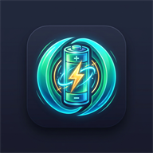
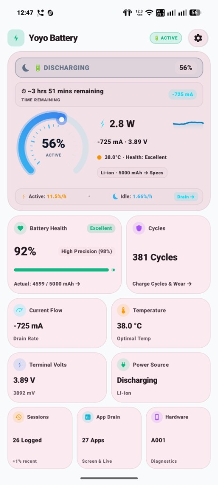
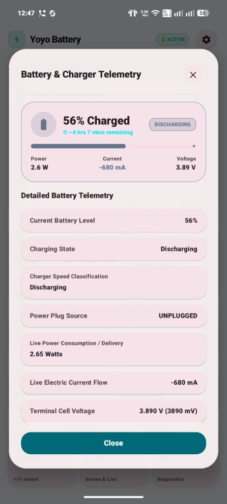
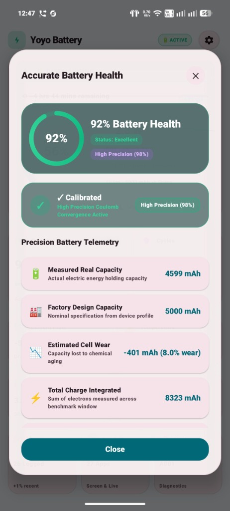
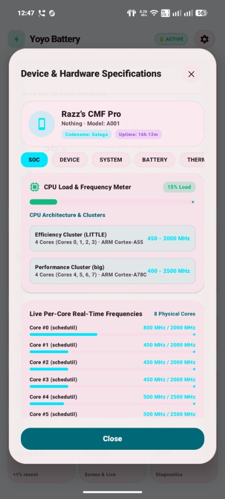

<p align="center">
  
</p>

<h1 align="center">Yoyo Battery</h1>

<p align="center">
  <strong>Next-Generation Battery Health, Live Charging Telemetry & Hardware Diagnostics for Android</strong>
</p>

<p align="center">
  <a href="https://github.com/razzishu/Yoyo-battery/releases"></a>
  <a href="https://t.me/Yoyoapps"></a>
  <a href="https://github.com/razzishu/Yoyo-battery/blob/main/LICENSE"></a>
  <a href="https://kotlinlang.org"></a>
  <a href="https://developer.android.com/jetpack/compose"></a>
</p>

---

## 📖 Overview

**Yoyo Battery** is an open-source, privacy-first Android battery companion and deep hardware monitor. Built entirely with modern **Kotlin** and **Jetpack Compose Material You (Expressive)**, it provides laboratory-grade insights into battery charging wattage, real chemical battery health, per-app battery drain, and authentic Linux kernel hardware specifications.

Unlike conventional battery apps, Yoyo Battery is **100% offline, tracker-free, and contains zero ads**. All telemetry and charging history are processed on-device and stored in a private, encrypted SQLite database.

---

## ✨ Features

### 🔋 Futuristic Automotive Tachometer Battery Gauge
* **22-Tick Radial Arc**: Precision tachometer meter design featuring multi-stop radiant gradient paths, subtle glow aura, and an illuminated beacon dot indicating real-time charge level.
* **Instant First-Glance Metrics**: View live power in **Watts (W)** with a dynamic 16-point sparkline graph, instantaneous flow (**mA**), terminal voltage (**V**), temperature (**°C**), battery health %, chemistry technology, capacity (**mAh**), and active/idle drain rates at a glance.
* **Instant Polarity Snapping**: Zero-lag Exponential Moving Average (EMA) filtering that immediately snaps upon charger connection/disconnection without slow cross-zero drift.

### 🧪 Coulomb Integration & Multi-Session Battery Health Engine
* **Laboratory Precision**: Integrates actual electric charge ($I \times \Delta t$) during uninterrupted benchmark charging cycles ($\ge 10\%$ gain) to calculate true available milliamp-hours.
* **10-Session Moving Window**: Eliminates single-session outliers by computing a weighted average across your **last 10 benchmark charging sessions**, achieving up to **98% confidence accuracy**.
* **Educational Telemetry**: Transparently reveals capacity loss (mAh), cell wear percentage, average chemical efficiency (mAh/%), calibration progress stages, and complete Coulomb formula math.

### ⚡ Deep Hardware & System Diagnostics Engine
* **Live Kernel CPU Core Frequencies**: Directly reads Linux kernel Energy-Aware Scheduling (EAS) policies (`/sys/devices/system/cpu/cpufreq/policy*`), displaying live MHz per core and clearly labeling offline cores as *Stopped*.
* **Exact SoC Disambiguation**: Eliminates ambiguous naming (e.g., MediaTek Dimensity 7300, 7300 Energy, 7300-Ultra; Snapdragon 888 vs 888+; Dimensity 7200 vs 7200 Pro) using authentic OEM brand metadata, platform properties, and clock thresholds.
* **Comprehensive Camera2 Specifications**: Inspects native physical pixel pitch (microns) with 4-in-1 Quad-Bayer ratios, optical diagonal/horizontal FOV (degrees), Camera2 API hardware tier (Level 3/Full), ISO range, manual exposure limits, focus modes (PDAF/Macro), zoom range, and RAW10/DNG capture support.
* **Panel Display & Thermals**: Queries unscaled physical display panels (`getRealMetrics`), dynamic refresh rates (60Hz–144Hz), HDR capabilities, wide color gamuts, and granular thermal sensor zones across CPU cores, GPU, battery cell, surface skin, and modem.

### 🎨 Material You & Glassmorphic Aesthetics
* **Adaptive Wallpaper Palette**: Dynamic color scheme adapting natively to Android 12+ wallpaper accents.
* **Frosted Glass Popup Sheets**: Modal telemetry dialogs feature translucent glassmorphism with subtle borders, elevation depth, and fluid spring animations.
* **Swipeable Hardware Categories**: Effortlessly swipe horizontally between 7 hardware diagnostic tabs (*SOC, Device, System, Battery, Thermal, Sensors, Cameras*) with synchronized category chip scrolling.

### 📊 Private History Log, Backup & Restore
* **Local Offline SQLite Database**: Track every charging session with start/end percentages, duration, mAh gained, peak current, max temperature, voltage, and charger protocol.
* **CSV & JSON Data Portability**: Export your complete charging history for external analysis or seamlessly restore backups across device switches via Android's secure `FileProvider`.

### 🛡️ Battery Protection & Nightly Quiet Hours
* **Smart Charge Alarms**: Configurable audio/vibration alerts when reaching 80% charge (protects anode chemistry) or dropping below 20% level (avoids deep discharge strain).
* **Thermal Protection Warnings**: Instant high-priority overheat alerts when battery temperature crosses safe thermal limits ($42^\circ\text{C}$).
* **Nightly Quiet Hours**: Automatic silent or vibrate-only notifications during sleep hours (e.g., 22:00 – 07:00).

### 🔔 Compact Statusbar Notification & Widgets
* **Default Compact Normal Mode**: Packs complete live telemetry (Level %, Charging Speed, Watts, Time to Full/Remaining, Current mA, Terminal Volts, Temp °C) in normal collapsed mode.
* **Rich Pull-Down Expansion**: Swiping down expands detailed multi-line electrical and charger protocol telemetry.
* **Resizable Homescreen Widgets**: Adaptive widget dynamically scales from a compact battery bar into an expanded diagnostic card showing time remaining, health, and design capacity.

---

## 📱 Screenshots

<p align="center">
  
  &nbsp;
  
  &nbsp;
  
  &nbsp;
  
</p>

| **Dashboard Overview** | **Battery Telemetry** | **Accurate Battery Health** | **Hardware Specifications** |
|:---:|:---:|:---:|:---:|
| Automotive Tachometer & live power | Electric flow, voltage & wattage | Coulomb convergence & cell wear | Kernel EAS core MHz & architecture |

---

## 🚀 Download & Installation

### Option 1: GitHub Releases (Recommended)
Download the latest signed, optimized production APK directly from the GitHub Releases page:
* **[Download Latest Release (v2.0.5)](https://github.com/razzishu/Yoyo-battery/releases)**

### Option 2: Telegram Channel
Get instant release updates, beta builds, and direct APK drops from the official Telegram channel:
* **[Join @Yoyoapps on Telegram](https://t.me/Yoyoapps)**

### Option 3: F-Droid (Official Repository)
Yoyo Battery is 100% free and open-source software and is submitted to the official **F-Droid** repository via `fdroiddata`.
* **Package Name**: `com.yoyo.battery.dashboard`
* **Metadata Recipe**: [`fdroid/com.yoyo.battery.dashboard.yml`](fdroid/com.yoyo.battery.dashboard.yml)

---

## 🛠️ Building from Source

### Prerequisites
* **Android Studio Ladybug | 2024.2+** or **IntelliJ IDEA**
* **JDK 17** or **JDK 21**
* **Android SDK**: `compileSdk 35`, `minSdk 31`, `targetSdk 35`

### Build Steps

1. **Clone the Repository**:
   ```bash
   git clone https://github.com/razzishu/Yoyo-battery.git
   cd Yoyo-battery
   ```

2. **Build Debug APK**:
   ```bash
   ./gradlew assembleDebug
   ```

3. **Build Optimized Production Release APK**:
   ```bash
   ./gradlew assembleRelease
   ```
   The signed, R8-minified APK will be generated at:
   `app/build/outputs/apk/release/app-release.apk`

---

## 🔒 Privacy & Permissions

Yoyo Battery requires **no internet permission** to perform its core battery and hardware monitoring. Your data never leaves your device.

| Permission | Purpose |
|---|---|
| `POST_NOTIFICATIONS` | Displays real-time live battery telemetry in the status bar and sends protection alarms. |
| `FOREGROUND_SERVICE_SPECIAL_USE` | Keeps background session tracking active for accurate Coulomb integration and battery health history. |
| `RECEIVE_BOOT_COMPLETED` | Automatically resumes session monitoring when the device reboots. |
| `PACKAGE_USAGE_STATS` *(Optional)* | Used strictly on-device to attribute per-app battery drain. |
| `REQUEST_IGNORE_BATTERY_OPTIMIZATIONS` *(Optional)* | Allows background monitoring to continue reliably across strict OEM battery savers. |

---

## 🌐 Community & Support

* **Source Code**: [github.com/razzishu/Yoyo-battery](https://github.com/razzishu/Yoyo-battery)
* **Telegram Channel**: [@Yoyoapps](https://t.me/Yoyoapps)
* **Issue Tracker**: [Report Bugs or Request Features](https://github.com/razzishu/Yoyo-battery/issues)

---

## 📄 License

This project is licensed under the **GNU General Public License v3.0 (GPL-3.0)**.
See the [LICENSE](LICENSE) file for the full text.

```text
Yoyo Battery - Next-Generation Battery & Hardware Companion for Android
Copyright (C) 2026 razzishu and contributors.

This program is free software: you can redistribute it and/or modify
it under the terms of the GNU General Public License as published by
the Free Software Foundation, either version 3 of the License, or
(at your option) any later version.

This program is distributed in the hope that it will be useful,
but WITHOUT ANY WARRANTY; without even the implied warranty of
MERCHANTABILITY or FITNESS FOR A PARTICULAR PURPOSE.  See the
GNU General Public License for more details.

You should have received a copy of the GNU General Public License
along with this program.  If not, see <https://www.gnu.org/licenses/>.
```
